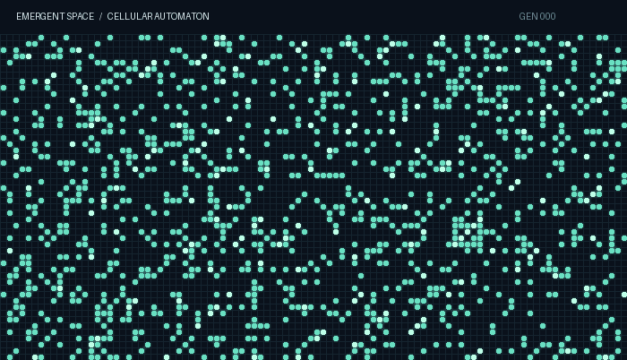
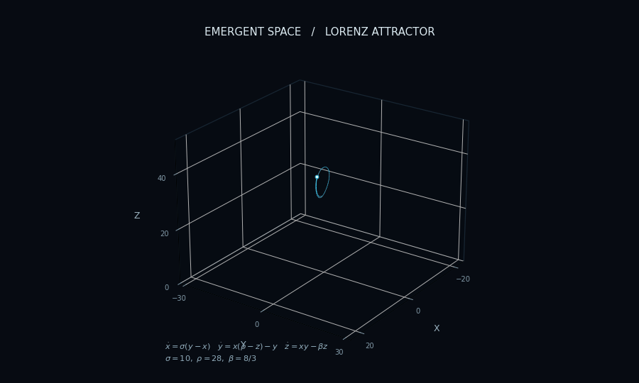

# E M E R G E N T  S P A C E

### Exploring the science of emergence.

**Artificial Life · Complexity Science · Dynamical Systems · Self-Organization**

 

*How does complexity arise from simplicity?*

 

---

## About

An independent exploration of artificial life, complex systems, and emergent phenomena.

Interested in understanding how life, intelligence, order, and self-organization arise from relatively simple interactions and underlying physical principles.

**Emergent Space** serves as a personal research laboratory, experimental archive, and collection of ongoing intellectual explorations.

---

## Visual Explorations

### 01 — Cellular Automata

*Conway's Game of Life*

An exploration of how complex patterns and behaviors emerge from simple local rules.

 

### 02 — Strange Attractors

*The Lorenz System*

A deterministic dynamical system exhibiting sensitive dependence on initial conditions and chaotic behavior.

---

## Research Interests

| Domain | Areas of Exploration |
|:---|:---|
| **Artificial Life** | Origins of life, digital organisms, evolutionary systems, open-ended evolution |
| **Complexity Science** | Emergence, nonlinear dynamics, self-organization, complex adaptive systems |
| **Collective Intelligence** | Swarm intelligence, decentralized coordination, distributed computation |
| **Computational Systems** | Cellular automata, agent-based models, artificial ecosystems, evolutionary computation |
| **Theoretical Foundations** | Cybernetics, information theory, dynamical systems, philosophy of science |

---

## The Laboratory

A growing collection of research material and original work.

- `research/` — Literature reviews, annotated papers, and theoretical notes.
- `experiments/` — Simulations, computational models, and exploratory implementations.
- `ideas/` — Hypotheses, conceptual frameworks, and research questions.
- `projects/` — Longer-term investigations and original research.
- `resources/` — Books, papers, datasets, and useful references.

---

## Guiding Questions

- How does life emerge from non-living matter?
- Can open-ended evolution arise in artificial systems?
- How does intelligence emerge from decentralized interactions?
- What are the fundamental principles governing self-organization?
- Are there general laws underlying complexity across different domains?
- Can we develop a unified understanding of emergence across physical, biological, and computational systems?

---

---

**EMERGENT SPACE**

*An ongoing exploration of life, complexity, and the emergence of order.*

 

`OBSERVE` · `MODEL` · `EXPERIMENT` · `UNDERSTAND`

